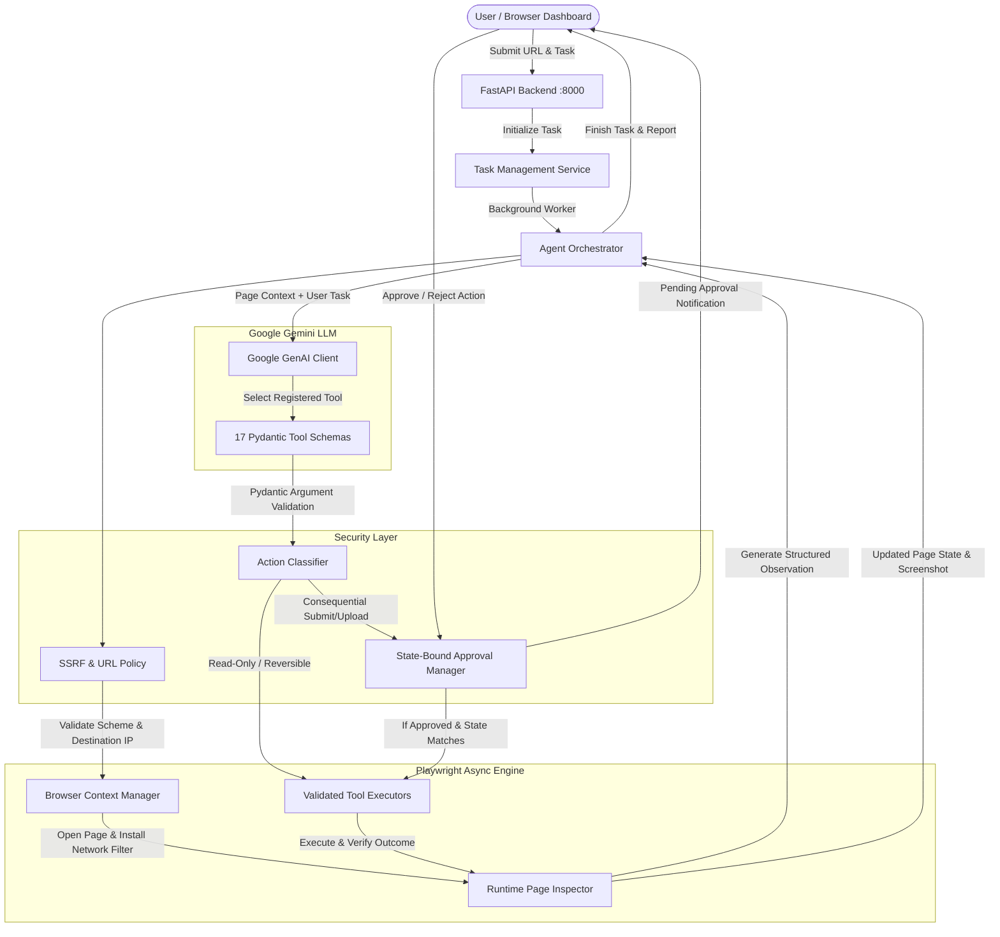

# Generic AI Web Automation Agent — Gemini + Playwright

An autonomous, production-oriented AI Web Automation Agent built from scratch using **Google Gemini** (via the official `google-genai` SDK), **Playwright for Python**, **FastAPI**, and **React + TypeScript + Vite**.

The agent accepts any website URL and natural language instructions, dynamically inspects the live page using DOM and accessibility tree analysis (without fragile hardcoded selectors), reasons through the optimal sequence of browser actions, requests explicit user approval for consequential mutations, executes verified actions, and compiles a comprehensive outcome report.

---

## Architecture Overview



---

## Core Capabilities & Features

1. **Runtime Page Inspection**:
   - Analyzes DOM accessibility roles, names, headings, inputs, selects, buttons, and forms on the fly.
   - Assigns task-scoped temporary element identifiers (`el-1`, `el-2`, etc.) to interactive elements.
   - Summarizes page information cleanly to prevent token explosion.
   - Computes state hashes to detect page drift.

2. **Official Google GenAI SDK (`google-genai`)**:
   - Uses `from google.genai import Client, types`.
   - Native structured tool calling with 17 Function Declarations.
   - Strict Pydantic argument validation before any execution.
   - Configurable model with centralized default (`gemini-3.5-flash-lite`).
   - Mock responder support for offline and automated integration testing without consuming API credits.

3. **Deterministic Browser Execution**:
   - Powered by Playwright Python's asynchronous API.
   - Isolated browser context per task for clean state isolation.
   - Outbound network request interception to block SSRF attempts against subresources.
   - Automated outcome verification: verifies input values, dropdown selections, checked states, and URL updates after every action.

4. **Multi-Tier Security & SSRF Protection**:
   - **URL Security**: Restricts to HTTP/HTTPS, resolves hostname IPs, and blocks private (`10.0.0.0/8`, `192.168.0.0/16`, `172.16.0.0/12`), loopback (`127.0.0.0/8`, `::1`), link-local, multicast, and cloud metadata endpoints (`169.254.169.254`, `metadata.google.internal`).
   - **Redirect Revalidation**: Re-inspects post-redirect URLs; aborts navigation if redirected to prohibited targets.
   - **Action Classification**:
     - *Read-only*: `inspect_page`, `extract_text`, `extract_table`, `take_screenshot`, `verify_element`, `wait_for_element`.
     - *Reversible*: `fill_input`, `select_option`, `check_checkbox`, `uncheck_checkbox`, `scroll_page`, `navigate`.
     - *Consequential*: `upload_file`, clicking submit/payment/order buttons, or any state-modifying submission.
   - **Explicit User Approval**: Consequential actions halt execution and request approval in the UI, bound to the exact page state hash (expiring if state drifts).
   - **Prompt Injection Defense**: Treats website content as untrusted data; enforces server-side tool execution boundaries that webpage text cannot bypass.

5. **Production-Ready Dashboard UI**:
   - React 19 + TypeScript + Vite with sleek dark glassmorphism and micro-animations.
   - Real-time activity log showing step-by-step tool decisions, arguments, and verified outcomes.
   - Live browser screenshot viewer with auto-refresh.
   - Interactive Consequential Action Approval banner.
   - Exportable audit report (JSON).

---

## Distinction: Reasoning, Execution & Verification

| Stage | Responsibility | Mechanism |
| :--- | :--- | :--- |
| **LLM Reasoning** | Determine *what* to do based on user instruction and page observation | Configured Gemini model prompt evaluation (`gemini-3.5-flash-lite`) |

| **Tool Selection** | Pick a validated browser action with structured arguments | Gemini Function Calling (`types.FunctionCall`) |
| **Server-Side Authorization** | Verify permissions, SSRF safety, and classify consequential impact | Python Security Policy + Approval Workflow |
| **Browser Execution** | Interact with the actual Chromium browser instance | Playwright asynchronous API calls |
| **Outcome Verification** | Prove that the operation actually succeeded before continuing | DOM attribute queries, value checks, URL changes |

---

## Technology Stack

- **Backend**: Python 3.12+ / 3.14, FastAPI, Uvicorn, Pydantic v2, Pydantic Settings
- **Browser Automation**: Playwright for Python (Chromium)
- **AI / LLM**: Google Gemini API via official `google-genai` SDK
- **Frontend**: React 19, TypeScript, Vite, Lucide Icons, Vanilla CSS Design System
- **Testing**: Pytest, Pytest-Asyncio, HTTPX, FastAPI TestClient

---

## Project Structure

```
Web access/
├── app/
│   ├── main.py                     # FastAPI app entry point & lifespan
│   ├── config.py                   # Pydantic Settings & configuration
│   ├── logging/
│   │   ├── __init__.py
│   │   └── setup.py                # Structured JSON logging & secret redaction
│   ├── security/
│   │   ├── __init__.py
│   │   ├── url_policy.py           # SSRF, DNS check & IP destination blocking
│   │   ├── action_policy.py        # Read-only / Reversible / Consequential classification
│   │   └── approvals.py            # State-bound approval lifecycle manager
│   ├── api/
│   │   ├── __init__.py
│   │   ├── routes.py               # REST API & embedded local test website
│   │   └── schemas.py              # Pydantic request/response schemas
│   ├── browser/
│   │   ├── __init__.py
│   │   ├── manager.py              # Playwright browser lifecycle & route filtering
│   │   ├── inspector.py            # Runtime DOM inspection & element tagging
│   │   ├── actions.py              # Deterministic tool implementations & verification
│   │   └── navigation.py           # Navigation with post-redirect SSRF validation
│   ├── agent/
│   │   ├── __init__.py
│   │   ├── state.py                # AgentTaskState state machine & audit log
│   │   ├── tool_registry.py        # 17 Pydantic schemas & Gemini declarations
│   │   ├── planner.py              # Turn formulation & conversation history
│   │   ├── executor.py             # Tool execution dispatcher
│   │   └── orchestrator.py         # End-to-end autonomous agent loop
│   ├── llm/
│   │   ├── __init__.py
│   │   ├── gemini_client.py        # google-genai wrapper with mock support
│   │   └── prompts.py              # Injection-resistant system instructions
│   └── services/
│       ├── __init__.py
│       └── task_service.py         # Concurrency control & background runner
├── frontend/
│   ├── src/
│   │   ├── components/
│   │   │   ├── Header.tsx          # System status header
│   │   │   ├── TaskCreationForm.tsx# Task launch form with presets
│   │   │   ├── LiveExecutionView.tsx# Split stream & live screenshot view
│   │   │   ├── ApprovalPanel.tsx   # Consequential action confirmation banner
│   │   │   ├── ActivityLog.tsx     # Step-by-step action stream
│   │   │   ├── ScreenshotViewer.tsx# Live browser capture viewer
│   │   │   └── ResultsReport.tsx   # Verified outcomes & final report
│   │   ├── services/
│   │   │   └── api.ts              # REST client calls
│   │   ├── types/
│   │   │   └── index.ts            # TypeScript definitions
│   │   ├── App.tsx                 # Main application state & polling
│   │   ├── main.tsx                # React entry
│   │   └── index.css               # Design system & dark glassmorphism
│   ├── index.html
│   ├── package.json
│   ├── tsconfig.json
│   └── vite.config.ts
├── tests/
│   ├── conftest.py                 # Pytest fixtures & mock clients
│   ├── test_url_policy.py          # SSRF & IP blocking tests
│   ├── test_action_policy.py       # Action classification & approval tests
│   ├── test_schemas_and_tools.py   # Tool argument validation tests
│   ├── test_state_machine.py       # Task state transition tests
│   ├── test_api_endpoints.py       # REST API integration tests
│   └── test_local_site_e2e.py      # End-to-end browser inspection & loop tests
├── pytest.ini
├── requirements.txt
├── Dockerfile
├── docker-compose.yml
├── .env.example
├── .gitignore
└── README.md
```

---

## Windows PowerShell Setup & Local Run Instructions

### 1. Prerequisites
- **Python**: 3.12+ (or 3.14)
- **Node.js**: v18+ (tested on Node v24)
- **PowerShell**: Windows PowerShell 5.1 or PowerShell 7+

### 2. Virtual Environment & Python Dependencies

Open a PowerShell terminal in the project directory:

```powershell
# Create Python virtual environment
python -m venv .venv

# If PowerShell script execution is restricted, run:
Set-ExecutionPolicy -Scope Process -ExecutionPolicy RemoteSigned

# Activate virtual environment
.\.venv\Scripts\Activate.ps1

# Upgrade pip and install all backend requirements
pip install -r requirements.txt

# Install Playwright Chromium browser binaries
playwright install chromium
```

### 3. Configure Environment Variables

```powershell
# Copy the example environment file
Copy-Item .env.example .env

# Set your Google Gemini API Key in .env or via PowerShell session:
$env:GEMINI_API_KEY = "your_actual_gemini_api_key_here"
```

> **Note**: For local automated testing and demo exploration on the built-in demo site, Gemini calls can also run using mock responders without an API key.

### 4. Install Frontend Dependencies

```powershell
cd frontend
npm install
cd ..
```

### 5. Running the Application

You will need **two PowerShell terminals**:

#### Terminal 1 — Start Backend Server:
```powershell
.\.venv\Scripts\Activate.ps1
python -m uvicorn app.main:app --host 127.0.0.1 --port 8000 --reload
```
*Backend is running at `http://127.0.0.1:8000` (Health check: `http://127.0.0.1:8000/health`).*

#### Terminal 2 — Start Frontend Dashboard:
```powershell
cd frontend
npm run dev
```
*Frontend dashboard is live at `http://localhost:5173`.*

---

## Running the Automated Test Suite

All 25 automated unit, integration, security, and end-to-end tests run locally **without requiring external websites or consuming Gemini credits**:

```powershell
.\.venv\Scripts\Activate.ps1
pytest -v tests/
```

### Test Coverage Highlights:
- **`test_url_policy.py`**: Verifies scheme enforcement, private IP blocks, cloud metadata blocks, and loopback rules.
- **`test_action_policy.py`**: Verifies action classification (Read-only vs Reversible vs Consequential) and approval lifecycle.
- **`test_schemas_and_tools.py`**: Validates all 17 tool argument models and Gemini function declarations.
- **`test_state_machine.py`**: Validates legal and illegal state transitions.
- **`test_api_endpoints.py`**: Validates `/health`, `/test-site`, `/test-site/submit`, and task CRUD routes.
- **`test_local_site_e2e.py`**: Full Playwright automation testing on live DOM, covering element inspection, form filling, dropdown selection, checkbox toggling, table extraction, and multi-step approval workflow.

---

## Running a Complete Demo

### Demo 1: Multi-Step Registration Form on Embedded Test Site
1. Open `http://localhost:5173` in your browser.
2. In the **Quick Example Presets**, click **"📋 Demo Form Fill & Submit"**.
   - URL: `http://127.0.0.1:8000/test-site`
   - Instruction: *"Open the registration form on this authorized demo website, fill in the name, email, and message fields using the information I provide, select the business tier, accept the terms, and prepare the form for submission."*
3. Click **"Launch Automation Task"**.
4. Watch the agent:
   - Navigate to the page.
   - Inspect the DOM and identify input fields, dropdown, checkbox, and submit button.
   - Fill in name and email.
   - Select the business tier and check the terms box.
   - Identify that clicking "Submit Registration" is a **Consequential Action**.
   - Halt in `WAITING_FOR_APPROVAL` state and render the **Approval Panel** in your dashboard.
5. Review the submitted arguments and click **"Approve & Execute Action"**.
6. The agent executes the submission, verifies the confirmation page, and outputs the final report with verified outcomes!

### Demo 2: Table Data Extraction
1. Click **"+ New Task"**.
2. Click **"📊 Extract Inventory Table"**.
3. Launch task. The agent inspects the table, calls `extract_table`, summarizes each item's stock and status, and completes with verified data.

---

## WhatsApp Web Contact Message Workflow (CDP Direct Mode)

AgentOS includes an end-to-end WhatsApp Web workflow that attaches directly to an existing, authenticated Google Chrome browser instance via the **Chrome DevTools Protocol (CDP)**.

### Security & Privacy Protections
- **Zero Credential Exposure**: The agent **never** asks for, reads, stores, or logs WhatsApp credentials, authentication tokens, session cookies, QR code payloads, or unrelated private chat messages.
- **Dedicated Browser Session**: Attaches non-destructively to your dedicated Chrome session without creating fresh unauthenticated profiles or restarting your browser.
- **Strict Recipient Verification**: Verifies the active chat title in the conversation header (`#main header`) before drafting.
- **No Blind Retries**: If message send status is ambiguous, the agent inspects the conversation history and never blind-retries a send.
- **Human-in-the-Loop Send Confirmation**: The agent enters text into the message composer but **halts immediately**. It requires your explicit **Confirm & Send** click in the UI before clicking Send exactly once.

### Launching Dedicated Chrome with CDP
Before running the workflow, start Chrome with remote debugging enabled from Windows PowerShell:

```powershell
& "C:\Program Files\Google\Chrome\Application\chrome.exe" --remote-debugging-port=9222 --user-data-dir="C:\ChromeWhatsAppProfile"
```

1. In that Chrome window, open `https://web.whatsapp.com` and log in once (scan your QR code).
2. Keep the Chrome window open. The agent will discover and use this active session.

### Workflow Lifecycle Steps
1. **Connect CDP**: Attaches to `http://127.0.0.1:9222`.
2. **Verify Login**: Confirms that your WhatsApp Web session is logged in. If a QR code is detected, pauses with state `AWAITING_MANUAL_LOGIN` and prompts you to authenticate.
3. **Contact Search**: Searches for the recipient in WhatsApp's search bar.
4. **Ambiguity Resolution**: If multiple candidates match, pauses with state `AMBIGUOUS_CONTACT` and prompts you to select the intended contact from the UI.
5. **Header Verification**: Opens the chat and strictly verifies that `#main header` matches the selected contact.
6. **Draft in Composer**: Types the message into `#main footer [contenteditable]` without sending.
7. **Send Approval (Safety Gate)**: Displays a preview of the recipient, message text, and live screenshot. Pauses in state `WAITING_FOR_SEND_APPROVAL`.
8. **Explicit Send Confirmation**: Only upon your confirmation does the agent click Send once.
9. **Sent Verification**: Verifies that the outgoing message bubble appears in the conversation history before declaring success (`COMPLETED`).

---

## REST API Documentation

| Method | Endpoint | Description |
| :--- | :--- | :--- |
| `GET` | `/health` | System health check (Gemini readiness & model) |
| `POST` | `/api/tasks` | Create and launch a generic automation task |
| `GET` | `/api/tasks/{task_id}` | Retrieve generic task status, URL, and report |
| `POST` | `/api/tasks/{task_id}/approve` | Approve or reject a pending consequential action |
| `POST` | `/api/tasks/{task_id}/cancel` | Cancel an active task safely |
| `GET` | `/api/tasks/{task_id}/logs` | Retrieve step-by-step action execution logs |
| `GET` | `/api/tasks/{task_id}/screenshot` | Retrieve latest browser screenshot (PNG) |
| `POST` | `/api/whatsapp/tasks` | Start an autonomous WhatsApp Web contact message task via CDP |
| `GET` | `/api/whatsapp/tasks/{task_id}` | Retrieve WhatsApp task progress, candidates, preview, and logs |
| `POST` | `/api/whatsapp/tasks/{task_id}/select-contact` | Submit user selection for an ambiguous contact match |
| `POST` | `/api/whatsapp/tasks/{task_id}/approve-send` | Explicitly approve or reject sending the drafted message |
| `POST` | `/api/whatsapp/tasks/{task_id}/cancel` | Safely cancel WhatsApp task and clear the composer |
| `GET` | `/api/whatsapp/tasks/{task_id}/screenshot` | Retrieve latest WhatsApp automation screenshot |
| `GET` | `/test-site` | Embedded local demo test website |
| `POST` | `/test-site/submit` | Form submission endpoint for local testing |
| `GET` | `/test-whatsapp` | Embedded local WhatsApp Web DOM simulation for offline tests |


---

## Security Model & Limitations

1. **SSRF Defense**:
   - Outbound requests are checked at the application layer (`url_policy.py`) and intercepted at the Playwright browser context layer (`manager.py`) to block subresources from accessing internal networks.
   - By default, loopback and private networks are blocked unless `ALLOW_LOCAL_TEST_DOMAINS=true` is explicitly set in `.env` for local testing.
2. **Approval Expiration**:
   - Approvals are cryptographically bound to the SHA-256 hash of the interactive page state. If the target URL or page structure changes before approval is confirmed, the approval automatically expires.
3. **Prompt Injection Hardening**:
   - Model prompt templates clearly isolate untrusted webpage excerpts.
   - The LLM is restricted exclusively to invoking registered tools with strict Pydantic schemas. Arbitrary `eval` or `exec` execution is strictly disallowed.
4. **Credential Safety**:
   - Sensitive fields (passwords, API keys, cookies, bearer tokens) are scrubbed before writing to logs.

---

## Troubleshooting Guide

- **Playwright Browser Missing**:
  Run `playwright install chromium` in your activated virtual environment.
- **Execution Policy Error in PowerShell**:
  Run `Set-ExecutionPolicy -Scope Process -ExecutionPolicy RemoteSigned`.
- **Port 8000 Already in Use**:
  Change `BACKEND_PORT=8001` in `.env` and restart uvicorn.
- **Gemini API Key Error**:
  Ensure `GEMINI_API_KEY` is set in `.env` or in your environment variables. Ensure no extra spaces or quotes surround the key.
- **SSRF Blocked Localhost**:
  Set `ALLOW_LOCAL_TEST_DOMAINS=true` in `.env` when automating tests against `127.0.0.1` or `localhost`.
