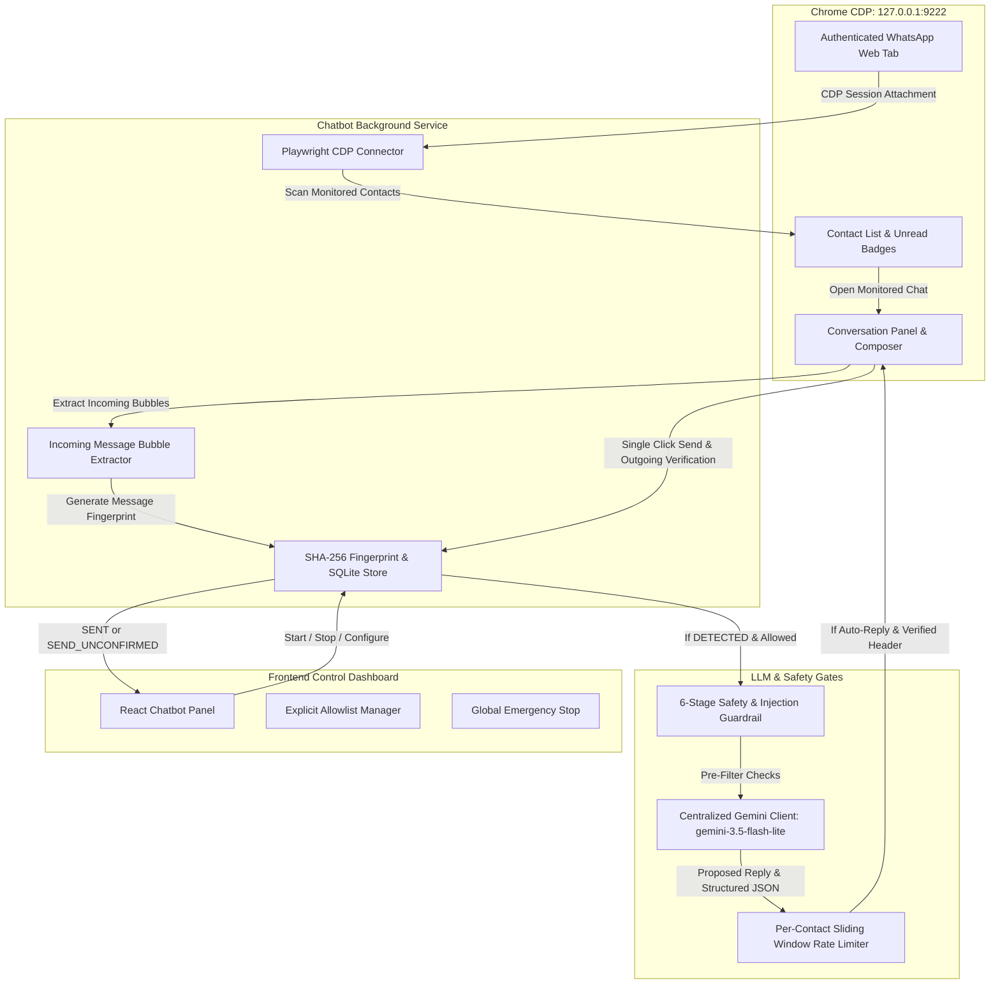

# Generic AI Web Automation Agent — Gemini + Playwright

An autonomous, production-oriented AI Web Automation Agent built from scratch using **Google Gemini** (via the official `google-genai` SDK), **Playwright for Python**, **FastAPI**, and **React + TypeScript + Vite**.

The agent accepts any website URL and natural language instructions, dynamically inspects the live page using DOM and accessibility tree analysis (without fragile hardcoded selectors), reasons through the optimal sequence of browser actions, requests explicit user approval for consequential mutations, executes verified actions, and compiles a comprehensive outcome report.

---

## Architecture Overview


---

## Core Capabilities & Features

1. **Runtime Page Inspection**:
   - Analyzes DOM accessibility roles, names, headings, inputs, selects, buttons, and forms on the fly.
   - Assigns task-scoped temporary element identifiers (`el-1`, `el-2`, etc.) to interactive elements.
   - Summarizes page information cleanly to prevent token explosion.
   - Computes state hashes to detect page drift.

2. **Official Google GenAI SDK (`google-genai`)**:
   - Uses `from google.genai import Client, types`.
   - Native structured tool calling with 17 Function Declarations.
   - Strict Pydantic argument validation before any execution.
   - Configurable model with centralized default (`gemini-3.5-flash-lite`).
   - Mock responder support for offline and automated integration testing without consuming API credits.

3. **Deterministic Browser Execution**:
   - Powered by Playwright Python's asynchronous API.
   - Isolated browser context per task for clean state isolation.
   - Outbound network request interception to block SSRF attempts against subresources.
   - Automated outcome verification: verifies input values, dropdown selections, checked states, and URL updates after every action.

4. **Multi-Tier Security & SSRF Protection**:
   - **URL Security**: Restricts to HTTP/HTTPS, resolves hostname IPs, and blocks private (`10.0.0.0/8`, `192.168.0.0/16`, `172.16.0.0/12`), loopback (`127.0.0.0/8`, `::1`), link-local, multicast, and cloud metadata endpoints (`169.254.169.254`, `metadata.google.internal`).
   - **Redirect Revalidation**: Re-inspects post-redirect URLs; aborts navigation if redirected to prohibited targets.
   - **Action Classification**:
     - *Read-only*: `inspect_page`, `extract_text`, `extract_table`, `take_screenshot`, `verify_element`, `wait_for_element`.
     - *Reversible*: `fill_input`, `select_option`, `check_checkbox`, `uncheck_checkbox`, `scroll_page`, `navigate`.
     - *Consequential*: `upload_file`, clicking submit/payment/order buttons, or any state-modifying submission.
   - **Explicit User Approval**: Consequential actions halt execution and request approval in the UI, bound to the exact page state hash (expiring if state drifts).
   - **Prompt Injection Defense**: Treats website content as untrusted data; enforces server-side tool execution boundaries that webpage text cannot bypass.

5. **Production-Ready Dashboard UI**:
   - React 19 + TypeScript + Vite with sleek dark glassmorphism and micro-animations.
   - Real-time activity log showing step-by-step tool decisions, arguments, and verified outcomes.
   - Live browser screenshot viewer with auto-refresh.
   - Interactive Consequential Action Approval banner.
   - Exportable audit report (JSON).

---

## Distinction: Reasoning, Execution & Verification

| Stage | Responsibility | Mechanism |
| :--- | :--- | :--- |
| **LLM Reasoning** | Determine *what* to do based on user instruction and page observation | Configured Gemini model prompt evaluation (`gemini-3.5-flash-lite`) |

| **Tool Selection** | Pick a validated browser action with structured arguments | Gemini Function Calling (`types.FunctionCall`) |
| **Server-Side Authorization** | Verify permissions, SSRF safety, and classify consequential impact | Python Security Policy + Approval Workflow |
| **Browser Execution** | Interact with the actual Chromium browser instance | Playwright asynchronous API calls |
| **Outcome Verification** | Prove that the operation actually succeeded before continuing | DOM attribute queries, value checks, URL changes |

---

## Technology Stack

- **Backend**: Python 3.12+ / 3.14, FastAPI, Uvicorn, Pydantic v2, Pydantic Settings
- **Browser Automation**: Playwright for Python (Chromium)
- **AI / LLM**: Google Gemini API via official `google-genai` SDK
- **Frontend**: React 19, TypeScript, Vite, Lucide Icons, Vanilla CSS Design System
- **Testing**: Pytest, Pytest-Asyncio, HTTPX, FastAPI TestClient

---

## Project Structure

```
Web access/
├── app/
│   ├── main.py                     # FastAPI app entry point & lifespan
│   ├── config.py                   # Pydantic Settings & configuration
│   ├── logging/
│   │   ├── __init__.py
│   │   └── setup.py                # Structured JSON logging & secret redaction
│   ├── security/
│   │   ├── __init__.py
│   │   ├── url_policy.py           # SSRF, DNS check & IP destination blocking
│   │   ├── action_policy.py        # Read-only / Reversible / Consequential classification
│   │   └── approvals.py            # State-bound approval lifecycle manager
│   ├── api/
│   │   ├── __init__.py
│   │   ├── routes.py               # REST API & embedded local test website
│   │   └── schemas.py              # Pydantic request/response schemas
│   ├── browser/
│   │   ├── __init__.py
│   │   ├── manager.py              # Playwright browser lifecycle & route filtering
│   │   ├── inspector.py            # Runtime DOM inspection & element tagging
│   │   ├── actions.py              # Deterministic tool implementations & verification
│   │   └── navigation.py           # Navigation with post-redirect SSRF validation
│   ├── agent/
│   │   ├── __init__.py
│   │   ├── state.py                # AgentTaskState state machine & audit log
│   │   ├── tool_registry.py        # 17 Pydantic schemas & Gemini declarations
│   │   ├── planner.py              # Turn formulation & conversation history
│   │   ├── executor.py             # Tool execution dispatcher
│   │   └── orchestrator.py         # End-to-end autonomous agent loop
│   ├── llm/
│   │   ├── __init__.py
│   │   ├── gemini_client.py        # google-genai wrapper with mock support
│   │   └── prompts.py              # Injection-resistant system instructions
│   └── services/
│       ├── __init__.py
│       └── task_service.py         # Concurrency control & background runner
├── frontend/
│   ├── src/
│   │   ├── components/
│   │   │   ├── Header.tsx          # System status header
│   │   │   ├── TaskCreationForm.tsx# Task launch form with presets
│   │   │   ├── LiveExecutionView.tsx# Split stream & live screenshot view
│   │   │   ├── ApprovalPanel.tsx   # Consequential action confirmation banner
│   │   │   ├── ActivityLog.tsx     # Step-by-step action stream
│   │   │   ├── ScreenshotViewer.tsx# Live browser capture viewer
│   │   │   └── ResultsReport.tsx   # Verified outcomes & final report
│   │   ├── services/
│   │   │   └── api.ts              # REST client calls
│   │   ├── types/
│   │   │   └── index.ts            # TypeScript definitions
│   │   ├── App.tsx                 # Main application state & polling
│   │   ├── main.tsx                # React entry
│   │   └── index.css               # Design system & dark glassmorphism
│   ├── index.html
│   ├── package.json
│   ├── tsconfig.json
│   └── vite.config.ts
├── tests/
│   ├── conftest.py                 # Pytest fixtures & mock clients
│   ├── test_url_policy.py          # SSRF & IP blocking tests
│   ├── test_action_policy.py       # Action classification & approval tests
│   ├── test_schemas_and_tools.py   # Tool argument validation tests
│   ├── test_state_machine.py       # Task state transition tests
│   ├── test_api_endpoints.py       # REST API integration tests
│   └── test_local_site_e2e.py      # End-to-end browser inspection & loop tests
├── pytest.ini
├── requirements.txt
├── Dockerfile
├── docker-compose.yml
├── .env.example
├── .gitignore
└── README.md
```

---

## Windows PowerShell Setup & Local Run Instructions

### 1. Prerequisites
- **Python**: 3.12+ (or 3.14)
- **Node.js**: v18+ (tested on Node v24)
- **PowerShell**: Windows PowerShell 5.1 or PowerShell 7+

### 2. Virtual Environment & Python Dependencies

Open a PowerShell terminal in the project directory:

```powershell
# Create Python virtual environment
python -m venv .venv

# If PowerShell script execution is restricted, run:
Set-ExecutionPolicy -Scope Process -ExecutionPolicy RemoteSigned

# Activate virtual environment
.\.venv\Scripts\Activate.ps1

# Upgrade pip and install all backend requirements
pip install -r requirements.txt

# Install Playwright Chromium browser binaries
playwright install chromium
```

### 3. Configure Environment Variables

```powershell
# Copy the example environment file
Copy-Item .env.example .env

# Set your Google Gemini API Key in .env or via PowerShell session:
$env:GEMINI_API_KEY = "your_actual_gemini_api_key_here"
```

> **Note**: For local automated testing and demo exploration on the built-in demo site, Gemini calls can also run using mock responders without an API key.

### 4. Install Frontend Dependencies

```powershell
cd frontend
npm install
cd ..
```

### 5. Running the Application

You will need **two PowerShell terminals**:

#### Terminal 1 — Start Backend Server:
```powershell
.\.venv\Scripts\Activate.ps1
python -m uvicorn app.main:app --host 127.0.0.1 --port 8000 --reload
```
*Backend is running at `http://127.0.0.1:8000` (Health check: `http://127.0.0.1:8000/health`).*

#### Terminal 2 — Start Frontend Dashboard:
```powershell
cd frontend
npm run dev
```
*Frontend dashboard is live at `http://localhost:5173`.*

---

## Running the Automated Test Suite

All 25 automated unit, integration, security, and end-to-end tests run locally **without requiring external websites or consuming Gemini credits**:

```powershell
.\.venv\Scripts\Activate.ps1
pytest -v tests/
```

### Test Coverage Highlights:
- **`test_url_policy.py`**: Verifies scheme enforcement, private IP blocks, cloud metadata blocks, and loopback rules.
- **`test_action_policy.py`**: Verifies action classification (Read-only vs Reversible vs Consequential) and approval lifecycle.
- **`test_schemas_and_tools.py`**: Validates all 17 tool argument models and Gemini function declarations.
- **`test_state_machine.py`**: Validates legal and illegal state transitions.
- **`test_api_endpoints.py`**: Validates `/health`, `/test-site`, `/test-site/submit`, and task CRUD routes.
- **`test_local_site_e2e.py`**: Full Playwright automation testing on live DOM, covering element inspection, form filling, dropdown selection, checkbox toggling, table extraction, and multi-step approval workflow.

---

## Running a Complete Demo

### Demo 1: Multi-Step Registration Form on Embedded Test Site
1. Open `http://localhost:5173` in your browser.
2. In the **Quick Example Presets**, click **"📋 Demo Form Fill & Submit"**.
   - URL: `http://127.0.0.1:8000/test-site`
   - Instruction: *"Open the registration form on this authorized demo website, fill in the name, email, and message fields using the information I provide, select the business tier, accept the terms, and prepare the form for submission."*
3. Click **"Launch Automation Task"**.
4. Watch the agent:
   - Navigate to the page.
   - Inspect the DOM and identify input fields, dropdown, checkbox, and submit button.
   - Fill in name and email.
   - Select the business tier and check the terms box.
   - Identify that clicking "Submit Registration" is a **Consequential Action**.
   - Halt in `WAITING_FOR_APPROVAL` state and render the **Approval Panel** in your dashboard.
5. Review the submitted arguments and click **"Approve & Execute Action"**.
6. The agent executes the submission, verifies the confirmation page, and outputs the final report with verified outcomes!

### Demo 2: Table Data Extraction
1. Click **"+ New Task"**.
2. Click **"📊 Extract Inventory Table"**.
3. Launch task. The agent inspects the table, calls `extract_table`, summarizes each item's stock and status, and completes with verified data.

---

## WhatsApp Web Contact Message Workflow (CDP Direct Mode)

AgentOS includes a verified, human-in-the-loop WhatsApp Web workflow that attaches directly to an existing, authenticated Google Chrome browser instance via the **Chrome DevTools Protocol (CDP)** at `http://127.0.0.1:9222`.

### 1. Configuration & Mode Clarification

When the backend starts up, you will see logging such as:
```text
Browser headless: True | Local test mode: True
```
- **`BROWSER_HEADLESS=True`**: This setting applies **only** to the generic web agent when it launches a fresh, isolated Chromium context for standard web tasks. It **does not affect** the WhatsApp CDP connection, which attaches directly to your externally running, visible Chrome browser.
- **`Local test mode: True` (`ALLOW_LOCAL_TEST_DOMAINS=true`)**: This setting allows the SSRF security policy (`url_policy.py`) to permit navigation to loopback addresses (`127.0.0.1` / `localhost`) for testing embedded demo pages (e.g. `/test-site` and `/test-whatsapp`). It **never** replaces real WhatsApp browser actions with mocks or simulated responses during live execution. In live mode, the agent targets `https://web.whatsapp.com` exclusively.

### 2. Chrome CDP Preflight & Safety Checks

To prevent generic `connect ECONNREFUSED 127.0.0.1:9222` exceptions, AgentOS implements a non-blocking **CDP connection preflight**:
1. **Loopback Enforced**: Rejects connection attempts to any host other than `127.0.0.1` or `localhost` to protect against remote browser hijacking.
2. **HTTP Version Probe**: Probes `http://127.0.0.1:9222/json/version` using HTTP before Playwright attempts CDP attachment.
3. **Actionable Root Cause**: If Chrome is not running or listening, the workflow halts immediately and returns clear PowerShell instructions.
4. **Session Ownership & Non-Destructive Disconnect**: The user retains full ownership of their Chrome session. When Playwright completes or disconnects (`browser.close()`), it cleanly detaches the CDP client—it **never** closes the user's Chrome window or active tabs.
5. **Zero Credential Exposure**: The agent never reads, logs, stores, or extracts cookies, session tokens, QR code images, or private chat histories.

### 3. Launching Dedicated Chrome with Remote Debugging

Before initiating a WhatsApp workflow, launch a dedicated Chrome instance with remote debugging enabled from **Windows PowerShell**:

```powershell
& "C:\Program Files\Google\Chrome\Application\chrome.exe" --remote-debugging-port=9222 --user-data-dir="C:\ChromeWhatsAppProfile"
```

Verify that Chrome is listening on port 9222:
```powershell
Invoke-RestMethod -Uri http://127.0.0.1:9222/json/version
```
*(You should receive a JSON response showing the Chrome browser version and DevTools WebSocket URL).*

In that dedicated Chrome window:
1. Navigate to `https://web.whatsapp.com`.
2. Log in manually if required (scan the QR code using your phone).
3. Keep the Chrome window open. AgentOS will automatically discover and reuse this authenticated session.

### 4. Verified Workflow Lifecycle & Two Explicit Sending Modes

The workflow supports two explicit sending modes selected via the UI toggle:

* **Mode 1: Manual Approval Mode (Default)**
  - Finds and strictly verifies the recipient header.
  - Drafts the exact message in the composer.
  - Renders an explicit recipient and message preview card with a live screenshot.
  - Halts in state `WAITING_FOR_SEND_APPROVAL` and waits for explicit user confirmation before clicking Send.
* **Mode 2: Automatic Send Mode**
  - Requires explicit user selection on each task (defaults back to manual).
  - Finds the exact contact and handles ambiguous matches safely (still pauses if multiple candidates match).
  - Strictly verifies the recipient header matches the intended contact before composing.
  - Fills the composer and clicks Send automatically once verified.
  - Verifies the outgoing message bubble appears in the conversation before reporting success.
  - **Never** automatically resends if the result is uncertain.

#### 10-Step Lifecycle Details:
1. **Preflight & CDP Connect**: Verifies loopback binding, checks `http://127.0.0.1:9222/json/version`, and attaches via `chromium.connect_over_cdp()`.
2. **Login Verification**: Locates the WhatsApp Web tab and verifies that the chat list is visible. If a QR code is detected, halts with `AWAITING_MANUAL_LOGIN`.
3. **Contact Search**: Searches for the requested recipient in the search box (`#side input[aria-label*='Search']`).
4. **Ambiguity Resolution**: If multiple candidates match the query, pauses in `AMBIGUOUS_CONTACT` state and prompts the user to select the correct contact from the UI (even in automatic mode).
5. **Open Conversation & Header Verification**: Opens the chosen conversation and strictly verifies that the active chat header (`#main header`) matches the selected contact name.
6. **Draft in Composer**: Types the exact message into `#main footer [contenteditable]` without sending.
7. **Preview Generation**: Captures a live screenshot of the drafted message and prepares a recipient + message preview.
8. **Send Dispatch**:
   - In *Manual Mode*: Pauses in state `WAITING_FOR_SEND_APPROVAL` for explicit user confirmation.
   - In *Automatic Mode*: Logs explicit automatic mode selection and proceeds directly to sending.
9. **Single-Click Send**: Clicks the Send button (`span[data-icon='send']`) exactly once.
10. **Outgoing Bubble Verification**: Verifies that the sent message bubble appears in `#main` with the matching text. If the result is uncertain, marks the task failed and never blindly resends.

### 5. Screenshot Endpoint & Polling Behavior

- **Informative Status Responses**:
  - If a task is still connecting, `GET /api/whatsapp/tasks/{task_id}/screenshot` returns HTTP 404 with detail `Screenshot pending: task is currently in state '...'`.
  - If a task failed before any screenshot was captured (e.g. Chrome not running), returns HTTP 404 with detail `Screenshot unavailable: task failed before any screenshot was captured`.
  - Once captured, returns HTTP 200 with the live `image/png` screenshot.
- **Frontend Polling Termination**: The frontend stops polling as soon as the task reaches a terminal state (`COMPLETED`, `FAILED`, `CANCELLED`, `CONTACT_NOT_FOUND`, `AWAITING_MANUAL_LOGIN`), preventing infinite 404 polling loops.
- **No Fabricated Previews**: The dashboard never fabricates screenshots or claims a live view when the session is disconnected.

---

## WhatsApp Incoming-Message AI Chatbot

An autonomous, safety-gated conversational chatbot that attaches to your existing authenticated WhatsApp Web Chrome session via Chrome DevTools Protocol (CDP), monitors only explicitly selected contacts, detects new incoming messages, generates contextual replies using Google Gemini (`gemini-3.5-flash-lite`), and dispatches replies automatically only when all safety rules pass.

### 1. Architecture and Data Flow



### 2. Windows PowerShell Setup & CDP Health Check

1. **Launch Dedicated Chrome with CDP**:
   ```powershell
   & "C:\Program Files\Google\Chrome\Application\chrome.exe" `
       --remote-debugging-port=9222 `
       --user-data-dir="$env:LOCALAPPDATA\Google\Chrome\User Data\WhatsAppAutomation" `
       https://web.whatsapp.com
   ```
2. **Verify CDP Endpoint Health**:
   ```powershell
   Invoke-RestMethod -Uri "http://127.0.0.1:9222/json/version"
   ```
   Must return browser version information and `webSocketDebuggerUrl`.
3. **Manual WhatsApp Login**:
   - In the opened Chrome window, scan the QR code with WhatsApp on your phone if prompted.
   - Wait until chats and conversations are fully loaded.
   - Antigravity never requests or stores WhatsApp passwords, QR codes, session tokens, or private browser cookies.

### 3. Contact Allowlist & Safety Settings

- **Default State**: Disabled by default (`enabled: false`, `auto_reply_enabled: false`).
- **Empty Allowlist Safety**: An empty allowlist prevents monitoring and sending entirely.
- **Strict Name Matching**: Matches exact contact names (case-insensitive). Never matches partial or ambiguous names.
- **Per-Contact Controls**: Each contact can be individually paused or resumed at any time.
- **Rate Limiting**: Configurable maximum replies per contact within a sliding time window (default: 5 replies per 15 minutes).
- **Global Emergency Stop**: Instantly cancels background polling and detaches from the browser without closing your personal Chrome session.

### 4. Safety Guardrails & Reply Policy

Automated replies are dispatched only if **all** of the following conditions are satisfied:
1. Chatbot is enabled and automatic reply mode is explicitly turned ON.
2. The sender is explicitly allowlisted and unpaused.
3. Message is confidently identified as new and incoming (`.message-in`).
4. Message fingerprint has never been previously processed (durable SQLite deduplication).
5. Message content passes pre-LLM safety filters (blocks financial requests, medical/legal advice, harassment, prompt injections, and credentials).
6. Gemini response passes JSON validation (`intent`, `confidence >= 0.7`, `safety_passed == true`, `requires_manual_review == false`).
7. Proposed reply is within maximum character length (default: 160 characters).
8. Contact has not exceeded configured rate limits within the sliding window.
9. Active conversation header (`#main header`) matches the sender name immediately prior to composing.
10. Send is dispatched with a single click and verified via outgoing message bubble detection.

### 5. Durable Deduplication & Uncertain Send Reconciliation

- **Cryptographic Fingerprint**: Generated via `SHA-256(sender:incoming_text:timestamp:dom_id)`.
- **Crash Safety**: Stored atomically in local SQLite (`task_artifacts/chatbot.db`). Process restarts never trigger duplicate replies.
- **Uncertain Sends (`SEND_UNCONFIRMED`)**:
  - If Playwright encounters a timeout or inconclusive DOM verification after clicking Send, the message is marked `SEND_UNCONFIRMED`.
  - The chatbot **never** automatically resends an unconfirmed message.
  - The user can inspect the message in the dashboard and click **Reconcile** to manually verify whether it appeared in WhatsApp, marking it `SENT` or `SKIPPED`.

### 6. Limitations of DOM-Based WhatsApp Monitoring

- **Virtualization**: WhatsApp Web virtualizes chat history; only currently visible or recently loaded bubbles exist in the DOM.
- **Non-Standard IDs**: WhatsApp Web frequently obfuscates element classes and does not expose persistent server message UUIDs in the DOM.
- **Single Active Tab**: Only one conversation can be open and focused at a time in WhatsApp Web.
- **Browser Disconnection**: If Chrome or CDP is closed, monitoring halts safely and logs a disconnection reason without crashing.

---

## REST API Documentation

| Method | Endpoint | Description |
| :--- | :--- | :--- |
| `GET` | `/health` | System health check (Gemini readiness & model) |
| `POST` | `/api/tasks` | Create and launch a generic automation task |
| `GET` | `/api/tasks/{task_id}` | Retrieve generic task status, URL, and report |
| `POST` | `/api/tasks/{task_id}/approve` | Approve or reject a pending consequential action |
| `POST` | `/api/tasks/{task_id}/cancel` | Cancel an active task safely |
| `GET` | `/api/tasks/{task_id}/logs` | Retrieve step-by-step action execution logs |
| `GET` | `/api/tasks/{task_id}/screenshot` | Retrieve latest browser screenshot (PNG) |
| `POST` | `/api/whatsapp/tasks` | Start an autonomous WhatsApp Web contact message task via CDP |
| `GET` | `/api/whatsapp/tasks/{task_id}` | Retrieve WhatsApp task progress, candidates, preview, and logs |
| `POST` | `/api/whatsapp/tasks/{task_id}/select-contact` | Submit user selection for an ambiguous contact match |
| `POST` | `/api/whatsapp/tasks/{task_id}/approve-send` | Explicitly approve or reject sending the drafted message |
| `POST` | `/api/whatsapp/tasks/{task_id}/cancel` | Safely cancel WhatsApp task and clear the composer |
| `GET` | `/api/whatsapp/tasks/{task_id}/screenshot` | Retrieve latest WhatsApp automation screenshot |
| `GET` | `/api/chatbot/config` | Retrieve chatbot configuration and allowlist settings |
| `POST` | `/api/chatbot/config` | Update chatbot configuration (rate limits, auto-reply, intervals) |
| `GET` | `/api/chatbot/status` | Retrieve chatbot runtime status and recent messages |
| `POST` | `/api/chatbot/start` | Start background incoming message monitor |
| `POST` | `/api/chatbot/stop` | Stop background monitor safely |
| `POST` | `/api/chatbot/contacts` | Add a verified contact to the explicit allowlist |
| `DELETE` | `/api/chatbot/contacts/{contact_name}` | Remove a contact from the allowlist |
| `POST` | `/api/chatbot/contacts/{contact_name}/pause` | Pause automated replies for a specific contact |
| `POST` | `/api/chatbot/contacts/{contact_name}/resume` | Resume automated replies for a paused contact |
| `GET` | `/api/chatbot/messages` | List recent incoming messages and their processing lifecycle |
| `GET` | `/api/chatbot/messages/{message_id}` | Retrieve individual message processing record |
| `POST` | `/api/chatbot/messages/{message_id}/reconcile` | Reconcile an unconfirmed send without blind resending |
| `GET` | `/test-site` | Embedded local demo test website |
| `POST` | `/test-site/submit` | Form submission endpoint for local testing |
| `GET` | `/test-whatsapp` | Embedded local WhatsApp Web DOM simulation for offline tests |


---

## Security Model & Limitations

1. **SSRF Defense**:
   - Outbound requests are checked at the application layer (`url_policy.py`) and intercepted at the Playwright browser context layer (`manager.py`) to block subresources from accessing internal networks.
   - By default, loopback and private networks are blocked unless `ALLOW_LOCAL_TEST_DOMAINS=true` is explicitly set in `.env` for local testing.
2. **Approval Expiration**:
   - Approvals are cryptographically bound to the SHA-256 hash of the interactive page state. If the target URL or page structure changes before approval is confirmed, the approval automatically expires.
3. **Prompt Injection Hardening**:
   - Model prompt templates clearly isolate untrusted webpage excerpts.
   - The LLM is restricted exclusively to invoking registered tools with strict Pydantic schemas. Arbitrary `eval` or `exec` execution is strictly disallowed.
4. **Credential Safety**:
   - Sensitive fields (passwords, API keys, cookies, bearer tokens) are scrubbed before writing to logs.

---

## Troubleshooting Guide

- **Playwright Browser Missing**:
  Run `playwright install chromium` in your activated virtual environment.
- **Execution Policy Error in PowerShell**:
  Run `Set-ExecutionPolicy -Scope Process -ExecutionPolicy RemoteSigned`.
- **Port 8000 Already in Use**:
  Change `BACKEND_PORT=8001` in `.env` and restart uvicorn.
- **Gemini API Key Error**:
  Ensure `GEMINI_API_KEY` is set in `.env` or in your environment variables. Ensure no extra spaces or quotes surround the key.
- **SSRF Blocked Localhost**:
  Set `ALLOW_LOCAL_TEST_DOMAINS=true` in `.env` when automating tests against `127.0.0.1` or `localhost`.
